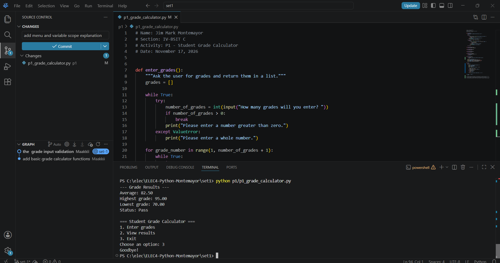
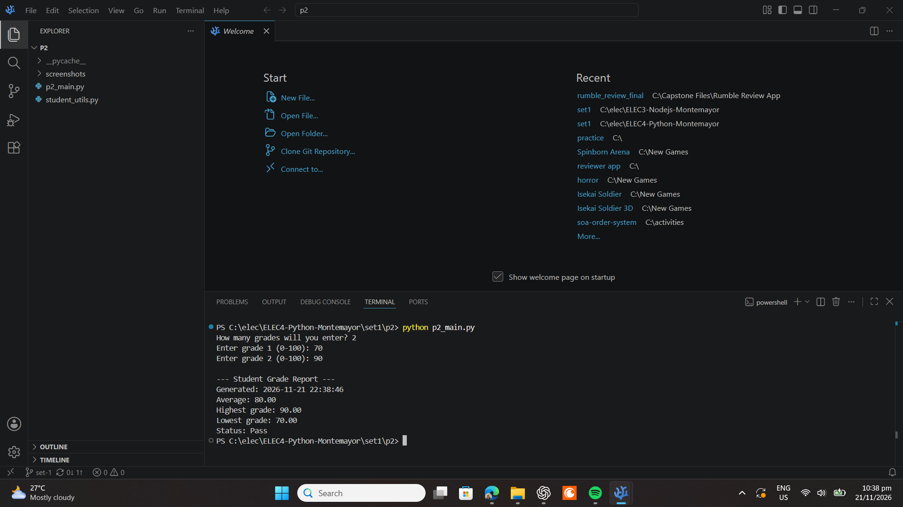
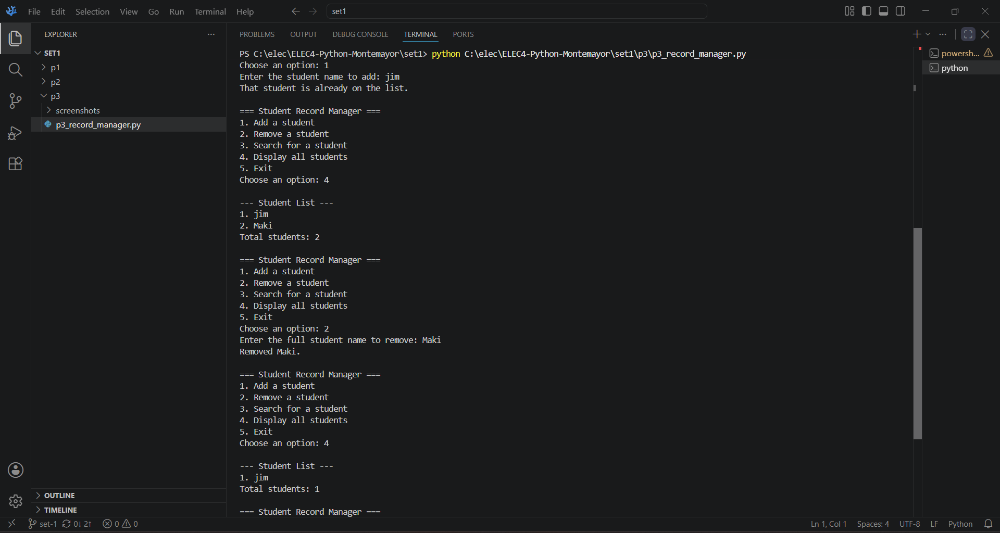
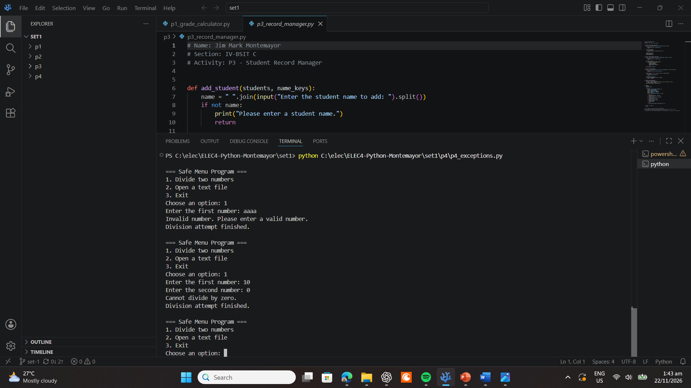
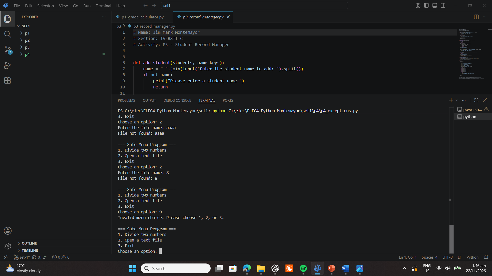

# ELEC 4 - Python Programming

**Name:** Jim Mark Montemayor  
**Section:** IV-BSIT C  
**Course:** ELEC 4 - Python Programming

## Set 1

- [P1: Student Grade Calculator](set1/p1/) - Menu-driven grade calculator using functions.
  - Run: `python set1/p1/p1_grade_calculator.py`
  - 

- [P2: Custom Module](set1/p2/) - Imports reusable grade functions to print a dated report.
  - Run: `python set1/p2/p2_main.py`
  - 

- [P3: Student Record Manager](set1/p3/) - Adds, removes, searches, and displays student names.
  - Run: `python set1/p3/p3_record_manager.py`
  - 

- [P4: Safe Menu Program](set1/p4/) - Demonstrates exception handling for division, opening a file, and menu input.
  - Run: `python set1/p4/p4_exceptions.py`
  - 
  - 
